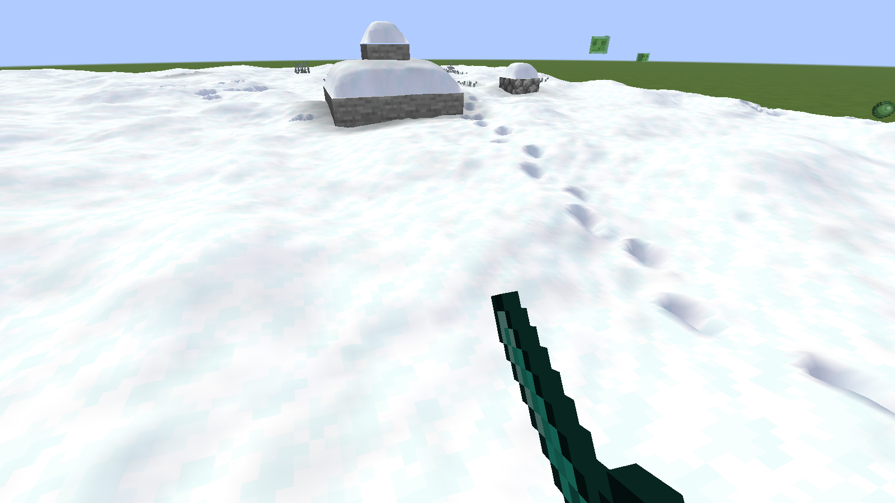
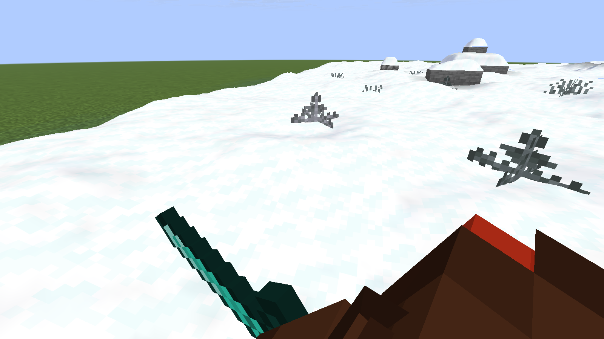
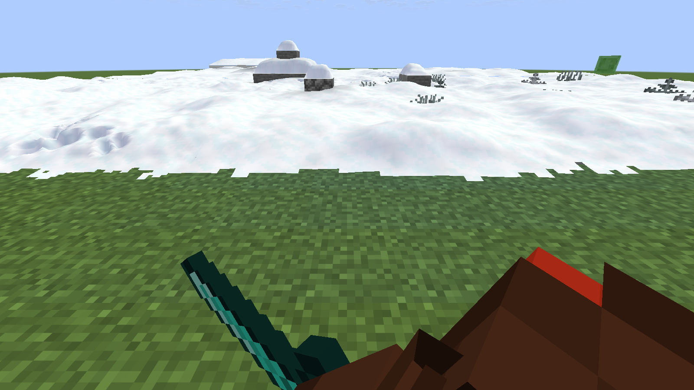
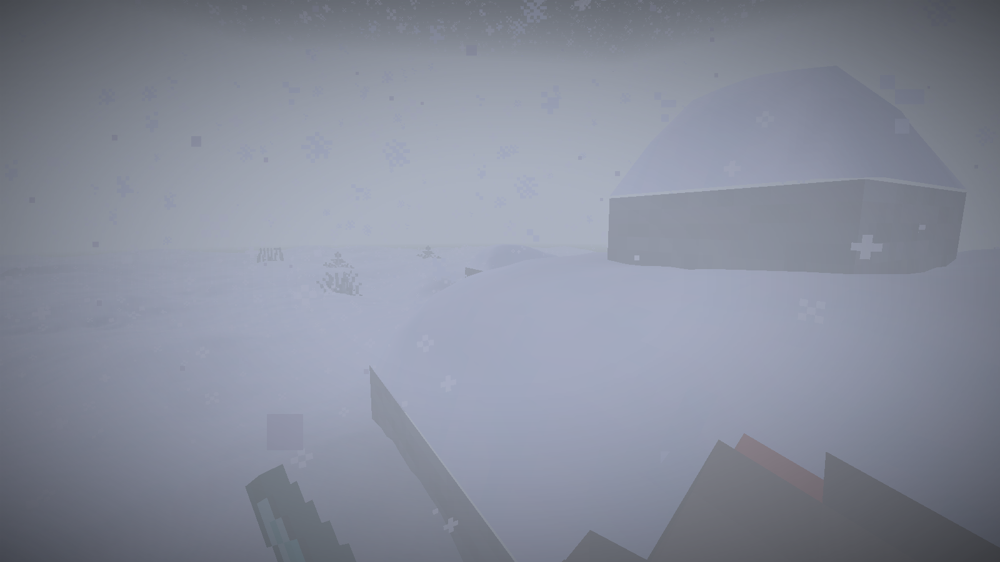

# Kotost Snow

A native mod for [Horizon](https://playhorizon.dev) (Minecraft: Java Edition 26.3 rewritten in Rust).

- **Soft snow.** Snow layers become one smooth surface: no steps between layers, no block grid, big gentle waves
  and small bumps, a soft blue-grey shade. At the edge of a snowfield the snow runs out raggedly over the grass
  instead of ending in a straight wall. Snow caps round off on blocks and pile up a little against walls.
- **Footprints.** Players and mobs press their feet into the snow: left and right in turn, longer steps when
  running, both feet on landing, a little snow dust kicked up. Prints stay for a while, then fill in; falling snow
  covers them faster.
- **Plants in snow.** Grass and bushes stand in the snow instead of in a hole, and turn white with frost.
- **Snowfall.** Flakes in the wind, a different kind each time it starts snowing (quiet flurries, steady snow,
  windy snow with gusts); with thunder a blizzard: thick flakes and powder, gusts and a white haze that closes in.
  Fresh powder builds up while it snows and settles after.

Everything is tuned in a text file while you play.

<table>
  <tr>
    <td width="50%"></td>
    <td width="50%"></td>
  </tr>
  <tr>
    <td width="50%"></td>
    <td width="50%"></td>
  </tr>
</table>

## Install

You need the Horizon launcher from [playhorizon.dev](https://playhorizon.dev) and a Microsoft account that owns
Minecraft: Java Edition.

1. Open the launcher, go to **Mods** and press **Add from GitHub**.
2. Paste `https://github.com/Leks2000/kotost-snow` and confirm.
   The launcher warns that native mods are not reviewed by the Horizon registry and run with full access to your
   computer. That is true of every native mod: read the source first (a few `.rs` files).
3. The launcher builds the game with the mod. **The first build takes a while** (it downloads Rust and Horizon's
   source; 20-40 minutes on an average PC). Later builds, after an update, take a few minutes.
4. Press Play.

Command line, the same thing:

```
horizon-launcher mods add-github https://github.com/Leks2000/kotost-snow --trust-native-code
```

Update: `horizon-launcher mods update-github kotost_snow`. Remove: Mods page, or `horizon-launcher mods remove kotost_snow`.

The mod is client-side only: servers need nothing, and it works in single player, on LAN and on any server.

**Deeper snow.** By default Minecraft never piles snow higher than one layer. To let snowfall build it up to a full
block, run once (as an operator, or in the server console):

```
/gamerule max_snow_accumulation_height 8
```

## Settings: `kotost-snow.txt`

The mod writes `config/kotost-snow.txt` in your game folder on its first run (the folder with `options.txt`). The
game re-reads it about once a second: save the file and the change shows in game, no restart (the snow surface is
rebuilt as you walk). A line you delete goes back to its default. `px` are texels, 1/16 of a block.

| Key | Default | What it does |
| --- | --- | --- |
| `enabled` | `1` | `0` turns the whole mod off. |
| `lift_px` | `3` | How much higher the snow is drawn than its collision: your feet sink in. |
| `depth_px` | `5` | A player's footprint depth (mobs scale it by their size). |
| `stride` | `0.72` | Blocks between two footprints of a walking player. |
| `fade_start`, `fade_len` | `150`, `150` | Seconds a footprint stays whole, then seconds it takes to fill in. |
| `mobs` | `1` | Mobs (and other players) leave footprints too. |
| `shade`, `blue` | `0.7`, `0.6` | Strength of the soft shading of slopes and footprints, and how blue the shade is. |
| `weather` | `1` | Snowfall effects: flakes in the wind, the blizzard's haze, fresh powder. |
| `flakes` | `1` | How many flakes (`0`-`3`). |
| `dust` | `1` | Snow dust kicked up by footsteps. |
| `frost` | `1` | Grass and bushes next to snow white with frost. |
| `debug` | `0` | `1` writes `kotost-snow-debug.log` in the game folder. |

`kotost-snow.txt` in this repository is the file the mod writes, with every key at its default.

Near you (20 blocks) the snow is drawn finely, with bumps and ragged edges; further away it is the same smooth
surface on a coarser grid, so the cost stays small (about half a millisecond a frame over snow on a test PC).

## How it works

Every hook is a `HEAD` hook (see `horizon-mixin.toml`):

- `Padded::fill` and `solid_rows`: a section is about to be meshed; the mod notes where its snow, walls and plants are.
- `Mesher::quad` (cancellable): every quad with the snow sprite is replaced by a height field: a quadratic B-spline
  over the snow heights of the columns around (so it is smooth from block to block), plus noise, minus the
  footprints; edges follow a coarser neighbour so there are no cracks. Plant quads next to snow get frost.
- `native_client_tick_post`: follows the walkers, stamps the footprints, spawns flakes and dust, and marks the
  sections to mesh again.
- `render_fog`: the blizzard's haze.

State lives in `runtime.rs`. The footprint idea follows [Soft Imprints](https://github.com/0Templ/SoftImprints)
by 0Templ (MIT); no code was copied, this is written for Horizon's Rust renderer.

Built for Horizon `fdc87ae` (nightly 2026-11-08); the launcher pins that commit when it builds the mod.

## License

MIT, see [LICENSE](LICENSE). Not affiliated with Mojang, Microsoft or the Horizon project.
